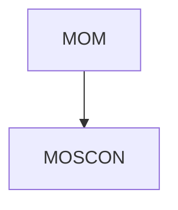

# 🌐 MOM — MetsuOS Methodology Framework

> **Soberanía, Trazabilidad ESA PSS-05 y Control Atómico para Proyectos de Software y Sistemas de IA.**

MOM (MetsuOS Methodology) es una arquitectura y conjunto de herramientas CLI/Compilador en Python diseñadas para gestionar especificaciones de conocimiento atómicas bajo el estándar de ingeniería de software **ESA PSS-05**. Resuelve de forma automática el grafo acíclico dirigido (DAG) de herencia entre proyectos, genera Vaults unificados navegables para Obsidian y produce contextos inmutables (`AGENTS.md`) para la integración segura con modelos de Lenguaje y Agentes de IA.

---

## 🚀 Características Principales

* **📑 Especificaciones Atómicas en JSON:** Gestión granular de requisitos, axiomas, diseños y guardrails categorizados por fases ESA (`COR`, `URD`, `SRD`, `ADD`, `DDD`).
* **🌳 Herencia y Redes DAG:** Permite que proyectos derivados hereden, extiendan y validen automáticamente el conocimiento de proyectos padres raíz.
* **🔄 Trazabilidad Bidireccional Automática:** El compilador calcula dinámicamente las relaciones de continuidad en todo el grafo; cada elemento padre identifica automáticamente a sus elementos hijos (`child_ids`).
* **🌐 Vault Global Unificado (`data/vault/`):** Genera una bóveda Obsidian holística que sincroniza todos los proyectos públicos del sistema, incluyendo un `INDEX.md` con **diagramas de jerarquía visual en Mermaid** y leyendas navegables.
* **🤖 Contextos inmutables para IA (`AGENTS.md`):** Extracción automática de *AI Guardrails* e instrucciones de seguridad obligatorias para alimentar agentes autónomos e LLMs.
* **📌 Versionado Riguroso de 4 Dígitos:** Control estricto del versionado de ficheros (`Project.File.Schema.Revision`, ej. `0.5.2.4`) manteniendo intacta la versión global definida manualmente en `project.json` / `pyproject.toml`.
* **💻 Interfaz CLI Interactiva y Robusta:** Menú TUI en consola (`cli.py`) equipado con conmutadores (switches) de estado visible, autogeneración de IDs correlativos y paneles de auditoría de métricas.

---

## 🛠️ Estructura del Repositorio

```text
.
├── data/
│   ├── projects/            # Proyectos registrados (project.json + specs/*.json)
│   │   ├── MOM/             # Proyecto raíz Metodológico
│   │   └── MOSCON/          # Proyecto derivado / específico
│   ├── ai-proposals/        # Propuestas atómicas pendientes de revisión de IA (FIFO)
│   └── vault/               # Vault Global Unificado de Obsidian (Generado)
│       ├── INDEX.md         # Índice principal con Diagrama Mermaid y Leyenda
│       ├── MOM/             # Réplica sincronizada del Vault de MOM
│       └── MOSCON/          # Réplica sincronizada del Vault de MOSCON
├── mom-py/                  # Núcleo del motor y herramientas CLI (v0.5.2)
│   ├── cli.py               # Menú interactivo y gestión de proyectos (v0.5.2.3)
│   ├── compiler.py          # Compilador Markdown, Obsidian y AGENTS.md (v0.5.2.4)
│   ├── projects.py          # Gestor de herencia DAG y repositorio unificado
│   └── schemas.py           # Modelos Pydantic / dataclasses (v0.5.2)
├── templates/               # Plantillas agnósticas globales de documentación
├── pyproject.toml           # Configuración y versión global del sistema (v0.5.2)
└── README.md                # Documentación principal del sistema
```

---

## 💻 Uso de la CLI Interactiva

Para iniciar el gestor interactivo de MOM, ejecuta el script `cli.py` desde la raíz o dentro del directorio `mom-py/`:

```bash
python mom-py/cli.py
```

### Menú Principal de MOM:

```text
=======================================================
     MOM (MetsuOS Methodology) - MENÚ PRINCIPAL       
    [PROYECTO ACTIVO: MOSCON]
=======================================================
  [1] Seleccionar / Cambiar proyecto activo
  [2] Crear un nuevo proyecto
  [3] Configurar proyecto (Visibilidad, Herencia y Metadatos)
  [4] Visualizar datos e inspeccionar proyecto activo
  [5] Crear NUEVA especificación atómica (JSON)
  [6] Editar especificación atómica EXISTENTE (JSON)
  [7] Compilar proyecto activo (Generar doc. MD, Vault Obsidian y AGENTS.md)
  [8] Compilar TODOS los proyectos registrados
  [9] Revisar y aprobar/rechazar propuestas de IA (data/ai-proposals/)
  [0] Salir
-------------------------------------------------------
```

---

## ⚙️ Compilación e Sincronización con Obsidian

Al ejecutar la compilación (Opción `[7]` para el proyecto activo o `[8]` para compilación masiva):

1. **Validación del Grafo:** Se verifica la integridad de las referencias de herencia entre elementos atómicos.
2. **Cálculo de Trazabilidad Bidireccional:** Se resuelven los enlaces inversos (`child_ids`) en cada nota.
3. **Generación de Entregables Locales:** Se crean los documentos Markdown consolidados (`COR.md`, `URD.md`, etc.) en `doc/`, el contexto para agentes `AGENTS.md` y la bóveda local `vault/`.
4. **Sincronización Vault Global (`data/vault/`):** Se actualiza la réplica del proyecto en la bóveda global y se reconstruye `data/vault/INDEX.md` renderizando el árbol gráfico Mermaid:



---

## 🏷️ Esquema de Versionado MOM

El proyecto sigue la convención de versionado de 4 dígitos:

$$\text{Versión del Fichero} = \text{Versión Global del Proyecto} . \text{Número Secuencial de Revisión}$$

* **Versión del Proyecto (`project.json` / `pyproject.toml`):** `0.5.2` (Fija hasta cambio manual por ajuste masivo).
* **Versión de los Scripts (`compiler.py` / `cli.py`):** `0.5.2.X` (Incrementa el 4º dígito con cada revisión del fichero).
* **Versión del Esquema (`schemas.py`):** `0.5.2` (Garantiza compatibilidad del modelo JSON).

---

## 🛡️ Licencia y Control

Desarrollado bajo principios de soberanía de datos y control de ingeniería para el ecosistema **MetsuOS**. Todos los derechos reservados.