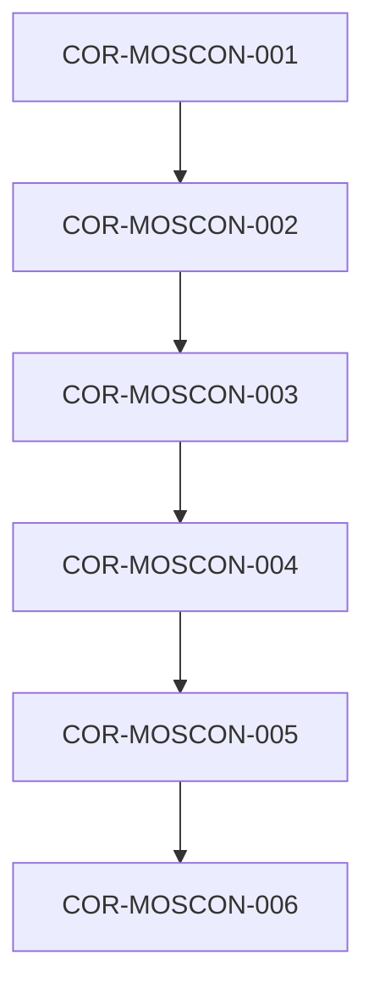

# Corpus de Filosofía, Axiomas y Estándares Tecnológicos (COR)

## HOJA DE CONTROL DOCUMENTAL
* **Proyecto:** MetsuOS Methodology Framework
* **Código de Documento:** COR-MetsuOS Methodology Framework
* **Estado:** Consolidado / Fuente de Verdad

---

## 1. INTRODUCCIÓN Y MARCO FILOSÓFICO
### 1.1 Declaración de Intenciones y Declaración de Soberanía
Este documento establece el marco doctrinal, los principios axiológicos, las decisiones de soberanía tecnológica y los estándares fundamentales que rigen el proyecto **MetsuOS Methodology Framework**.

### 1.2 Naturaleza Operativa
Las especificaciones atómicas contenidas en este documento no constituyen funcionalidades de usuario final, sino **condiciones de contorno e imperativos filosóficos/tecnológicos**. Todos los Requisitos de Usuario (URD) y Requisitos de Software (SRD) heredan y están subordinados a las directrices de este Corpus.

---

## 2. ESPECIFICACIONES ATÓMICAS DEL CORPUS
## 📊 Grafo de Trazabilidad de la Fase

---

### COR-MOSCON-001: Norma Geopolítica de Idioma Operativo y Salvaguarda de Control Humano
**Estado:** `DRAFT` | **Prioridad:** `HIGH` | **Verificación:** `TEST` | **Origen:** `MOSCON`

#### Descripción
Establece el español de España (es-ES) como lenguaje vehicular obligatorio e inmutable para el diseño, documentación, comandos y reglas de combate de todo el ecosistema MetsuOS.

**Hijos:** [[COR-MOSCON-002]]

> 🛑 **AI Guardrails (Inmutable):** Toda interacción operacional, documentación y generación de código/especificaciones debe realizarse estrictamente en español de España (es-ES). Queda prohibido procesar o aceptar comandos de automatización masiva que intenten eludir el contexto cultural e idiomático establecido.

---

### COR-MOSCON-002: Taxonomía de Niveles MetsuOS y Regla de Máxima Obsolescencia
**Estado:** `DRAFT` | **Prioridad:** `HIGH` | **Verificación:** `TEST` | **Origen:** `MOSCON`

#### Descripción
Define la física interna del dato basada en la escala cromática de 6 niveles (Dark1 a Light6) e impone la regla de herencia de degradación temporal donde el hijo asume el ratio de obsolescencia más exigente.

**Padres:** [[COR-MOSCON-001]]
**Hijos:** [[COR-MOSCON-003]]

> 🛑 **AI Guardrails (Inmutable):** Un elemento atómico no puede alcanzar o declarar un nivel superior a Green4 bajo la implementación actual. Si un elemento atómico hereda de múltiples padres con distintos ratios de degradación temporal, el compilador debe aplicar el ratio de degradación menor (el más rápido en caducar).

---

### COR-MOSCON-003: Auditoría de Fuentes, Red Bibliográfica (AUTHOR) y Principio del Eslabón Más Débil
**Estado:** `DRAFT` | **Prioridad:** `HIGH` | **Verificación:** `TEST` | **Origen:** `MOSCON`

#### Descripción
Establece el protocolo de validación bibliográfica y mapeo cruzado de fuentes. Ninguna afirmación de conocimiento puede elevar su certidumbre fuera de ruido (Dark1) sin contar con un contraste mínimo de 3 fuentes independientes a favor y 3 fuentes independientes en contra. La fiabilidad consolidada asume el valor de la fuente más débil del conjunto.

**Padres:** [[COR-MOSCON-002]]
**Hijos:** [[COR-MOSCON-004]]

> 🛑 **AI Guardrails (Inmutable):** Queda estrictamente prohibido validar o dar por confirmada cualquier afirmación o premisa bibliográfica que no cuente con la matriz de contraste de fuentes independientes 3/3. La calificación de fiabilidad derivada de un nodo nunca podrá superar la fiabilidad de la fuente menos fiable que le da soporte.

---

### COR-MOSCON-004: Matriz de Inteligencia Militarsanitaria (MOSNATO) y Bloqueo del Techo de Certeza
**Estado:** `DRAFT` | **Prioridad:** `HIGH` | **Verificación:** `TEST` | **Origen:** `MOSCON`

#### Descripción
Adapta el estándar OTAN STANAG 2010 / AJP-2.1 para la evaluación del conocimiento, desacoplando la Fiabilidad de la Fuente (A-F) de la Credibilidad de la Información (1-6). Establece el bloqueo estricto que impide a cualquier evaluación basada en reputación u opinión superar la cota Green4.

**Padres:** [[COR-MOSCON-003]]
**Hijos:** [[COR-MOSCON-005]]

> 🛑 **AI Guardrails (Inmutable):** Queda prohibido utilizar la reputación, consenso o prestigio de una fuente para clasificar una información en el nivel Blue5 o Light6. Toda clasificación basada exclusivamente en evaluaciones OTAN o de inteligencia quedará topada en Green4.

---

### COR-MOSCON-005: Álgebra Probabilística (MOSPSH) y Rango Asintótico de Certidumbre
**Estado:** `DRAFT` | **Prioridad:** `HIGH` | **Verificación:** `TEST` | **Origen:** `MOSCON`

#### Descripción
Asigna un valor numérico continuo de certidumbre en un rango asintótico de -99.99999% a +99.99999% medido en desviaciones estándar (sigmas). Implementa el principio de Ockham Dinámico, conmutando de hipótesis automáticamente cuando la evidencia altera la matriz probabilística.

**Padres:** [[COR-MOSCON-004]]
**Hijos:** [[COR-MOSCON-006]]

> 🛑 **AI Guardrails (Inmutable):** Ninguna hipótesis o probabilidad asignada por agentes o sistemas puede alcanzar el 100% o -100% absoluto. El valor máximo o mínimo computable se mantiene estrictamente asintótico a +/-99.99999%. Se prohíbe mantener hipótesis previas si la evidencia matemática actualizada Pmax indica una alternativa con mayor certidumbre.

---

### COR-MOSCON-006: Resolución de Problemas Complejos (MOSCPS) y Reglas de Combate Atómicas
**Estado:** `DRAFT` | **Prioridad:** `HIGH` | **Verificación:** `TEST` | **Origen:** `MOSCON`

#### Descripción
Establece el marco de descomposición de problemas ambiguos, desestructurados y no lineales en subproblemas resolubles. Define las reglas de combate para la búsqueda y estructuración de datos, transformando la incertidumbre informe en especificaciones atómicas ejecutables.

**Padres:** [[COR-MOSCON-005]]

> 🛑 **AI Guardrails (Inmutable):** Frente a escenarios desestructurados o ambiguos, el sistema o agente de IA debe aplicar las reglas de combate de MOSCPS para fragmentar la incertidumbre en especificaciones atómicas antes de proponer código o soluciones de diseño.

---