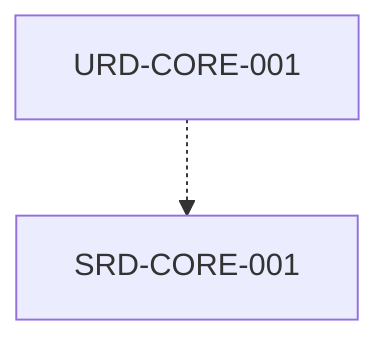

# Documento de Requisitos de Software (SRD)

## HOJA DE CONTROL DOCUMENTAL
* **Proyecto:** MetsuOS Methodology Framework
* **Código de Documento:** SRD-MetsuOS Methodology Framework
* **Estado:** Consolidado

---

## 1. INTRODUCCIÓN
### 1.1 Propósito
Especificar técnicamente las capacidades funcionales, no funcionales y de rendimiento del software para **MetsuOS Methodology Framework**.

### 1.2 Alcance
Traducción técnica formal de las necesidades expresadas en el Documento de Requisitos de Usuario (URD).

### 1.3 Trazabilidad
Todos los requisitos definidos en este documento heredan estrictamente de uno o más componentes definidos en el URD.

---

## 2. ENTORNO Y RESTRICCIONES TÉCNICAS
### 2.1 Modelo Operativo
Plataformas de ejecución, entornos de soporte y dependencias de infraestructura.

---

## 3. ESPECIFICACIONES ATÓMICAS DE REQUISITOS SOFTWARE
## 📊 Grafo de Trazabilidad de la Fase

---

### SRD-CORE-001: Persistencia JSON Atómica y Trazabilidad por Grafo Directed Acyclic Graph
**Estado:** `DRAFT` | **Prioridad:** `HIGH` | **Verificación:** `UNIT_TEST` | **Origen:** `MOM`

#### Descripción
El motor debe almacenar cada ítem en src//.json y verificar que todo ítem de fase SRD, ADD o DDD tenga asignado obligatoriamente al menos un parent_id existente en el grafo.

**Padres:** [[URD-CORE-001]]

---