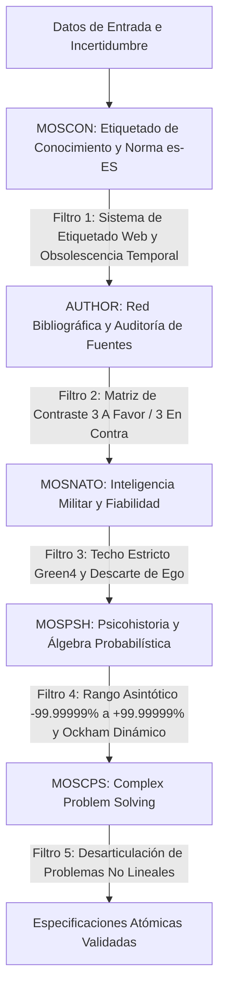
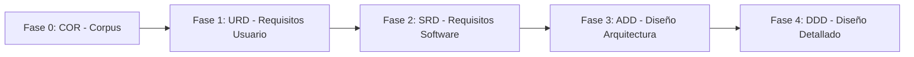

# MARCO CONCEPTUAL Y DOCUMENTO DE VISIÓN GENERAL (VISION)

## HOJA DE CONTROL DOCUMENTAL

### INFORMACIÓN GENERAL DEL PROYECTO
* **Nombre del Proyecto:** MOM (MetsuOS Methodology)
* **Código de Referencia:** MOM-COR-VISION-1.2
* **Entidad / Dominio:** MetsuOS Ecosystem
* **Estándar Metodológico Base:** ESA PSS-05 (Software Engineering Standards)
* **Versión Actual:** 1.2.0
* **Fecha de Emisión:** 17 de Octubre de 2026

---

### REGISTRO DE CAMBIOS Y HISTORIAL DE VERSIONES
| Versión | Descripción del Cambio | Autor / Rol | Fecha |
| :---: | :--- | :---: | :---: |
| **1.0.0** | Elaboración inicial del Documento de Visión Narrativa e Integración del Marco Doctrinal/Filosófico en MOM. | Metsuke (Arquitecto Principal) | 15/10/2026 |
| **1.1.0** | Integración del Núcleo `MOSCON`, Auditoría de Fuentes `AUTHOR`, Estándar `MOSNATO`, Álgebra Probabilística `MOSPSH` y Resolución Compleja de Problemas `MOSCPS`. | Metsuke (Arquitecto Principal) | 17/10/2026 |
| **1.2.0** | Sustitución de diagramas ASCII por Mermaid, incorporación de la referencia al sistema de etiquetado MOS de la web en `MOSCON` y análisis causal expandido de fortalezas, defectos y función anti-sesgo de los 5 bloques con CPS. | Metsuke (Arquitecto Principal) | 17/10/2026 |

---

### LISTA DE DISTRIBUCIÓN
* **Operadores del Sistema / Mantenedores Humanos**
* **Agentes de Inteligencia Artificial (AI Operators / Proposals Generators)**
* **Repositorio de Configuración Abierta de MOM**

---

## 1. INTRODUCCIÓN Y PROPÓSITO

### 1.1 Objetivo del Documento
El presente documento establece la **introducción general, el marco conceptual, las decisiones de soberanía y los fundamentos doctrinales** del sistema **MOM (MetsuOS Methodology)**.

A diferencia de las especificaciones atómicas estructuradas en formato JSON/Markdown individual (fases `COR`, `URD`, `SRD`, `ADD`, `DDD`), este documento ofrece una **redacción narrativa continua**, estructurada bajo la rigurosidad formal del estándar **ESA PSS-05**, sirviendo como puerta de entrada, onboarding contextual y justificación filosófica pre-fase 1.

### 1.2 Alcance del Marco Metodológico
MOM es un marco de desarrollo metodológico orientado a proyectos de software y sistemas complejos que prioriza:
1. **Soberanía Tecnológica Absoluta:** Minimización o eliminación de dependencias de terceros, asegurando que la lógica principal repose en la biblioteca estándar del lenguaje motor o en estándares abiertos duraderos (HTML, JSON, Markdown).
2. **Trazabilidad Bi-direccional Estricta:** Vínculos DAG (Grafo Acíclico Dirigido) desde los principios filosóficos iniciales hasta las funciones de código y pruebas de integración.
3. **Control Humano e Interoperabilidad con IA:** Un entorno donde los agentes de IA generan propuestas atómicas, pero la validación, aprobación e integración final recaen exclusivamente en el operador humano bajo un flujo FIFO inmutable.

---

## 2. MARCO DOCTRINAL Y FILOSOFÍA DE SOBERANÍA (CORPUS - FASE 0)

### 2.1 Naturaleza del Documento COR y Pre-URD
En las metodologías de ingeniería de software convencionales, las decisiones filosóficas, los límites de soberanía y los estándares organizativos se tratan como documentación informal o guías flotantes. En MOM, siguiendo la distinción de la ESA entre *Capacidades* y *Restricciones*, estas reglas constituyen el **Nivel 0 (COR / Corpus)** del grafo de herencia.

El **Corpus de Filosofía y Estándares (COR)** condiciona:
* **El Requisito de Usuario (URD):** Ningún usuario puede exigir una funcionalidad que viole un axioma de soberanía.
* **El Requisito de Software (SRD):** Las bibliotecas y arquitecturas elegidas deben responder a la política de autosuficiencia.
* **El Diseño de Arquitectura (ADD) y Detallado (DDD):** Los diagramas y flujos deben ser interpretables por herramientas estándar de texto plano sin formatos propietarios.

---

## 3. LOS CINCO PILARES EPISTEMOLÓGICOS Y SU TRAZABILIDAD CAUSAL

Para mitigar el ruido, la desinformación y los sesgos cognitivos propios de la ingesta de datos en el mundo real, la arquitectura del Corpus (Fase 0) articula cinco módulos especializados. Cada bloque cumple una función específica dentro de la cadena de procesamiento del conocimiento:

### 3.1 Detalle Causal y Mecanismos de Combate al Sesgo

#### I. `MOSCON` (MetsuOS Conocimiento - Núcleo y Norma Geopolítica)
* **Origen y Sistema de Etiquetado:** `MOSCON` implementa formalmente el **sistema de etiquetado de conocimiento de MetsuOS definido en la web oficial**, estructurando la escala cromática de 6 niveles (`⚫① Dark1` a `⚪⑥ Light6`).
* **Función Causal:** Establece la física interna del dato (estado, taxonomía y persistencia).
* **Control de Dominio y Seguridad Antiabuso:** Exige el **español de España (es-ES)** como lenguaje operativo primario. Esto actúa como un peaje geopolítico y de seguridad que impide la automatización masiva o el maluso del marco por parte de agentes externos sin contexto cultural directo.
* **Mecanismo Anti-Sesgo (Obsolescencia Temporal $\lambda$):** Combate el *sesgo de vigencia* o *anclaje temporal*. Todo dato caduca. Mediante la **Regla de Máxima Obsolescencia**, si un elemento hereda de dependencias con mayor tasa de obsolescencia, asume automáticamente el ratio más exigente (más rápido en degradarse) para evitar que premisas caducadas sostengan conclusiones activas.

#### II. `AUTHOR` (Auditoría de Fuentes y Red Bibliográfica)
* **Función Causal:** Construye la red explícita de citación, contraste y mapeo cruzado de literatura científica y documental.
* **Mecanismo Anti-Sesgo (Filtro 3/3 y Eslabón más Débil):** Combate el *sesgo de confirmación* y el *sesgo de fuente única*. Ninguna afirmación puede salir de la zona de ruido/no evaluable (`⚫① Dark1`) sin contar con un mínimo de **3 fuentes independientes a favor y 3 fuentes independientes en contra**. El valor consolidado no se calcula mediante promedios engañosos, sino aplicando el principio del eslabón más débil entre la fiabilidad de sus fuentes respaldantes.

#### III. `MOSNATO` (Adaptación del Estándar OTAN STANAG 2010 / AJP-2.1)
* **Función Causal:** Aplica la matriz militar de inteligencia que separa la **Fiabilidad de la Fuente (A–F)** de la **Credibilidad de la Información (1–6)**.
* **Mecanismo Anti-Sesgo (Bloqueo del Ego y Techo `Green4`):** Combate el *sesgo de autoridad* y la *ilusión de consenso*. Ninguna evaluación OTAN, por alta que sea, permite clasificar un ítem por encima del nivel `🟢④ Green4`. Los niveles `🔵⑤ Blue5` (demostración científica formal) y `⚪⑥ Light6` (axioma inmutable) quedan bloqueados bajo la implementación actual, asumiendo que el prestigio académico, el ego o el consenso social son constructos propensos a la contaminación ideológica.

#### IV. `MOSPSH` (MetsuOS Psicohistoria - Álgebra Probabilística)
* **Función Causal:** Asigna un valor numérico continuo de certidumbre en un rango asintótico estricto de **$-99.99999\%$ a $+99.99999\%$**, medido en desviaciones estándar o sigmas ($\sigma$).
* **Mecanismo Anti-Sesgo (Navaja de Ockham Dinámica):** Combate la *resistencia al cambio* y la *falacia de costos hundidos*. El sistema no cree en dogmas ni absolutos ($100\%$ de verdad no existe). La "opción más probable" es simplemente la hipótesis $P_{\max}$ del estado actual $S(t)$. Si entra un nuevo vector de evidencia que altera la matriz, el grafo conmuta de hipótesis automáticamente y sin fricción emocional.

#### V. `MOSCPS` (MetsuOS Complex Problem Solving)
* **Función Causal:** Integra la metodología de Resolución de Problemas Complejos inspirada en la arquitectura de Javier Recuenco. Se encarga de la **descomposición de problemas desestructurados, ambiguos y no lineales** en subproblemas resolubles.
* **Mecanismo Anti-Sesgo (Sistematización de Reglas de Combate):** Combate el *sesgo de parálisis por análisis* y el *sesgo de encuadre*. Al abordar un entorno complejo saturado de ruido, `MOSCPS` define las "reglas de combate" para la búsqueda de datos, guiando al operador o a la IA a través de árboles de decisión estructurados que transforman la incertidumbre informe en especificaciones atómicas ejecutables.

---

## 4. ANÁLISIS DE FORTALEZAS, DEFECTOS Y RETOS OPERATIVOS

La implementación real de este ecosistema epistemológico en producción presenta ventajas competitivas críticas, pero también exige reconocer sus límites inherentes y los retos de su gestión diaria:

### 4.1 Fortalezas (Virtudes de la Arquitectura)
* **Inmunidad al Dogma e Ilusión de Certeza:** La combinación de la asíntota de verdad en `MOSPSH` y el Ockham Dinámico impide que el sistema mantenga premisas obsoletas por inercia ideológica.
* **Aislamiento de la Contaminación por Eslabón más Débil:** Gracias a la trazabilidad en el DAG (`COR-MATH-002`), una fuente dudosa o un dato clasificado como `🔴② Rojo2` limita automáticamente la cota superior de todos los componentes que dependen de él.
* **Gobernanza Invariable de Agentes IA:** La proyección automática a `AGENTS.md` convierte las reglas de combate y guardrails en barreras infranqueables para los modelos de lenguaje, eliminando la deriva operativa en tareas de generación de código o especificaciones.
* **Soberanía y Durabilidad en Texto Plano:** La desacoplación total en archivos JSON en disco e interfaces Markdown inmuniza al sistema contra la obsolescencia de software propietario o cambios de API en terceros.

### 4.2 Defectos y Límites Inherentes
* **Riesgo de Falsa Precisión (Over-Precision):** Expresar la probabilidad de una hipótesis compleja con múltiples decimales (ej. $+84.32119\%$) puede generar una falsa sensación de certidumbre científica cuando descansa sobre estimaciones cualitativas iniciales.
* **Exigencia de Ingesta y Parálisis por Carga Cognitiva:** La disciplina requerida para satisfacer la regla 3/3 en `AUTHOR`, catalogar fuentes bajo la matriz OTAN y definir ratios de degradación $\lambda$ impone una alta carga de trabajo inicial. Sin la guía de `MOSCPS`, esta rigurosidad puede ralentizar la toma de decisiones en escenarios de alta velocidad.
* **Sensibilidad a la Calibración de la Degradación ($\lambda$):** Una tasa de degradación mal ajustada puede degradar innecesariamente conocimiento sólido a `Yellow3` (generando falso ruido) o, por el contrario, conservar conceptos caducados durante demasiado tiempo.

### 4.3 Retos Operativos y de Escala
* **Cómputo Reactivo de Grafo (Propagación DAG):** Cuando una premisa raíz varía su probabilidad o caduca por tiempo, recalcular el impacto en cascada a través de cientos de proyectos derivados exige algoritmos de propagación eficientes en el motor `mom-py`.
* **Fricción en el Factor Humano (Basura Estructurada):** El éxito del sistema depende de la honestidad y rigurosidad del operador humano. Si se introducen datos superficiales o por defecto para agilizar trámites (ej. clasificar fuentes masivamente como `A1`), el motor probabilístico se contamina con basura bien formateada.
* **Mantenimiento del Esquema Vivo:** Garantizar que las herramientas de automigración en disco evolucionen sin corromper metadatos bibliográficos ni romper enlaces de herencia `parent_ids` en bases de conocimientos masivas.

---

## 5. ESTRUCTURA Y CICLO DE VIDA EN ESA PSS-05 / MOM

El ciclo de vida en MOM sigue una progresión formal de 5 fases interconectadas:

### 5.1 Descripción Narrativa de las Fases

#### Fase 0: COR (Corpus de Filosofía, Axiomas, Epistemología y Estándares)
* **Propósito:** Definir los marcos éticos, tecnológicos, epistemológicos (`MOSCON`, `AUTHOR`, `MOSNATO`, `MOSPSH`, `MOSCPS`) y de soberanía del proyecto.
* **Carácter:** Raíz inmutable del grafo de herencia.

#### Fase 1: URD (User Requirements Document)
* **Propósito:** Especificar las necesidades operativas del usuario final o del cliente.
* **Carácter:** Define qué debe hacer el sistema desde una perspectiva funcional, vinculándose formalmente a los axiomas y límites del `COR`.

#### Fase 2: SRD (Software Requirements Document)
* **Propósito:** Traducir los `URD` a requisitos técnicos verificables de software.
* **Carácter:** Define las interfaces, formatos de datos, límites de memoria y métodos de verificación (`TEST`, `INSPECTION`, `ANALYSIS`, `DEMONSTRATION`).

#### Fase 3: ADD (Architectural Design Document)
* **Propósito:** Definir la estructura modular de alto nivel, la descomposición en subsistemas y la estrategia de persistencia/red.
* **Carácter:** Mapea la transformación de `SRD` a módulos arquitectónicos concretos.

#### Fase 4: DDD (Detailed Design Document)
* **Propósito:** Especificar las estructuras de datos exactas, algoritmos, firmas de funciones y modelos de clases/ficheros.
* **Carácter:** Base directa para la codificación y compilación.

---

## 6. GOBERNANZA Y MODO DE TRABAJO CON INTELIGENCIA ARTIFICIAL

MOM establece una separación clara de roles para prevenir el descontrol de código o especificaciones generadas automáticamente:

1. **Agentes de IA (Proposers):** Leen el contexto del proyecto (`AGENTS.md`, notas del `vault/` de Obsidian y especificaciones consolidadas) y generan propuestas atómicas estructuradas en `data/ai-proposals/`.
2. **Operador Humano (Approver):** Ejecuta la herramienta de gestión CLI (`mos.sh`), revisa las propuestas en orden estricto de llegada (FIFO), evalúa los *AI Guardrails* e integra o descarta los elementos.

---

## 7. CONCLUSIÓN Y CONTINUIDAD OPERATIVA

Este documento constituye la piedra angular narrativa del ecosistema MOM. Toda iteración sobre el código de los motores (`mom-py`, `mom-c`, `mom-js`) o sobre los proyectos creados dentro de la estructura `data/projects/` toma esta visión como el marco doctrinal predeterminado.