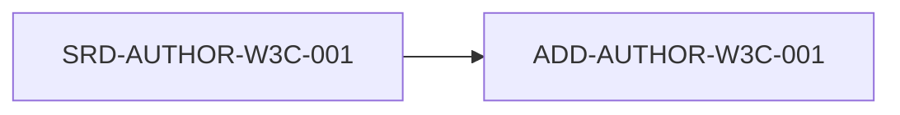

# ADD-AUTHOR-W3C-001: Criterio 1.1.1: Contenido no textual (Nivel A)

## Descripción
Todo el contenido no textual que se presenta al usuario tiene una alternativa de texto que sirve para el mismo propósito.

## Trazabilidad y Relaciones

* **Proyecto Origen:** `AUTHOR-W3C`
* **Padres:** [[SRD-AUTHOR-W3C-001]]
* **Hijos:** Ninguno

