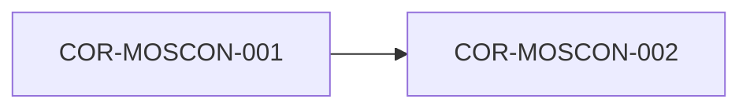

# COR-MOSCON-001: Norma Geopolítica de Idioma Operativo y Salvaguarda de Control Humano

## Descripción
Establece el español de España (es-ES) como lenguaje vehicular obligatorio e inmutable para el diseño, documentación, comandos y reglas de combate de todo el ecosistema MetsuOS.

## Trazabilidad y Relaciones

* **Proyecto Origen:** `MOSCON`
* **Padres:** Ninguno (Raíz)
* **Hijos:** [[COR-MOSCON-002]]

> 🛑 **AI Guardrails (Inmutable):** Toda interacción operacional, documentación y generación de código/especificaciones debe realizarse estrictamente en español de España (es-ES). Queda prohibido procesar o aceptar comandos de automatización masiva que intenten eludir el contexto cultural e idiomático establecido.
