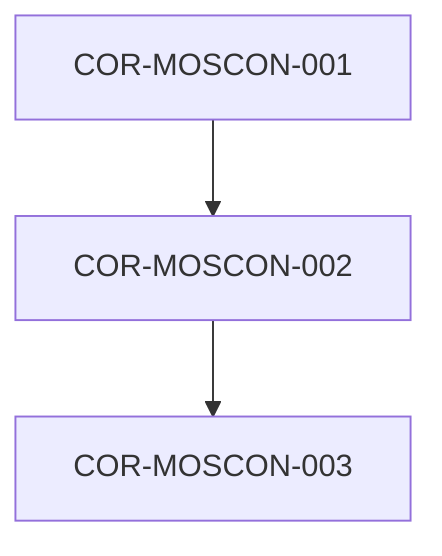

# COR-MOSCON-002: Taxonomía de Niveles MetsuOS y Regla de Máxima Obsolescencia

## Descripción
Define la física interna del dato basada en la escala cromática de 6 niveles (Dark1 a Light6) e impone la regla de herencia de degradación temporal donde el hijo asume el ratio de obsolescencia más exigente.

## Trazabilidad y Relaciones

* **Proyecto Origen:** `MOSCON`
* **Padres:** [[COR-MOSCON-001]]
* **Hijos:** [[COR-MOSCON-003]]

> 🛑 **AI Guardrails (Inmutable):** Un elemento atómico no puede alcanzar o declarar un nivel superior a Green4 bajo la implementación actual. Si un elemento atómico hereda de múltiples padres con distintos ratios de degradación temporal, el compilador debe aplicar el ratio de degradación menor (el más rápido en caducar).
