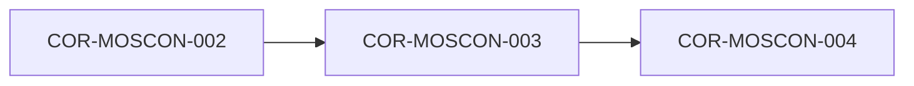

# COR-MOSCON-003: Auditoría de Fuentes, Red Bibliográfica (AUTHOR) y Principio del Eslabón Más Débil

## Descripción
Establece el protocolo de validación bibliográfica y mapeo cruzado de fuentes. Ninguna afirmación de conocimiento puede elevar su certidumbre fuera de ruido (Dark1) sin contar con un contraste mínimo de 3 fuentes independientes a favor y 3 fuentes independientes en contra. La fiabilidad consolidada asume el valor de la fuente más débil del conjunto.

## Trazabilidad y Relaciones

* **Proyecto Origen:** `MOSCON`
* **Padres:** [[COR-MOSCON-002]]
* **Hijos:** [[COR-MOSCON-004]]

> 🛑 **AI Guardrails (Inmutable):** Queda estrictamente prohibido validar o dar por confirmada cualquier afirmación o premisa bibliográfica que no cuente con la matriz de contraste de fuentes independientes 3/3. La calificación de fiabilidad derivada de un nodo nunca podrá superar la fiabilidad de la fuente menos fiable que le da soporte.
