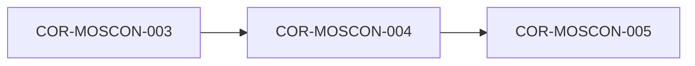

# COR-MOSCON-004: Matriz de Inteligencia Militarsanitaria (MOSNATO) y Bloqueo del Techo de Certeza

## Descripción
Adapta el estándar OTAN STANAG 2010 / AJP-2.1 para la evaluación del conocimiento, desacoplando la Fiabilidad de la Fuente (A-F) de la Credibilidad de la Información (1-6). Establece el bloqueo estricto que impide a cualquier evaluación basada en reputación u opinión superar la cota Green4.

## Trazabilidad y Relaciones

* **Proyecto Origen:** `MOSCON`
* **Padres:** [[COR-MOSCON-003]]
* **Hijos:** [[COR-MOSCON-005]]

> 🛑 **AI Guardrails (Inmutable):** Queda prohibido utilizar la reputación, consenso o prestigio de una fuente para clasificar una información en el nivel Blue5 o Light6. Toda clasificación basada exclusivamente en evaluaciones OTAN o de inteligencia quedará topada en Green4.
