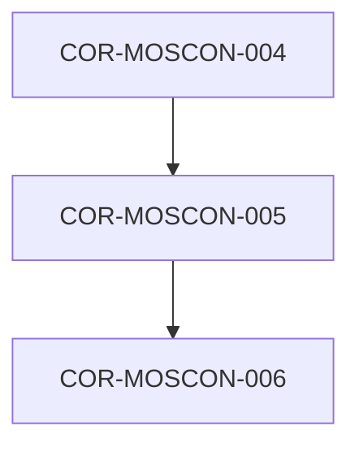

# COR-MOSCON-005: Álgebra Probabilística (MOSPSH) y Rango Asintótico de Certidumbre

## Descripción
Asigna un valor numérico continuo de certidumbre en un rango asintótico de -99.99999% a +99.99999% medido en desviaciones estándar (sigmas). Implementa el principio de Ockham Dinámico, conmutando de hipótesis automáticamente cuando la evidencia altera la matriz probabilística.

## Trazabilidad y Relaciones

* **Proyecto Origen:** `MOSCON`
* **Padres:** [[COR-MOSCON-004]]
* **Hijos:** [[COR-MOSCON-006]]

> 🛑 **AI Guardrails (Inmutable):** Ninguna hipótesis o probabilidad asignada por agentes o sistemas puede alcanzar el 100% o -100% absoluto. El valor máximo o mínimo computable se mantiene estrictamente asintótico a +/-99.99999%. Se prohíbe mantener hipótesis previas si la evidencia matemática actualizada Pmax indica una alternativa con mayor certidumbre.
