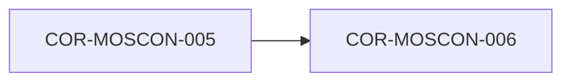

# COR-MOSCON-006: Resolución de Problemas Complejos (MOSCPS) y Reglas de Combate Atómicas

## Descripción
Establece el marco de descomposición de problemas ambiguos, desestructurados y no lineales en subproblemas resolubles. Define las reglas de combate para la búsqueda y estructuración de datos, transformando la incertidumbre informe en especificaciones atómicas ejecutables.

## Trazabilidad y Relaciones

* **Proyecto Origen:** `MOSCON`
* **Padres:** [[COR-MOSCON-005]]
* **Hijos:** Ninguno

> 🛑 **AI Guardrails (Inmutable):** Frente a escenarios desestructurados o ambiguos, el sistema o agente de IA debe aplicar las reglas de combate de MOSCPS para fragmentar la incertidumbre en especificaciones atómicas antes de proponer código o soluciones de diseño.
