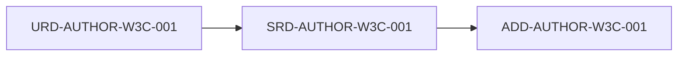

# SRD-AUTHOR-W3C-001: Pauta 1.1: Alternativas de texto

## Descripción
Proporcionar alternativas de texto para cualquier contenido no textual.

## Trazabilidad y Relaciones

* **Proyecto Origen:** `AUTHOR-W3C`
* **Padres:** [[URD-AUTHOR-W3C-001]]
* **Hijos:** [[ADD-AUTHOR-W3C-001]]

