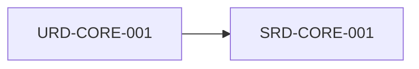

# URD-CORE-001: Motor de Especificación Atómica y Trazabilidad ESA PSS-05

## Descripción
El sistema MOM debe permitir declarar especificaciones atómicas en formato JSON agrupadas por las fases URD, SRD, ADD y DDD del estándar ESA PSS-05, garantizando trazabilidad bidireccional y resolución de herencia DAG entre proyectos sin dependencias externas.

## Trazabilidad y Relaciones

* **Proyecto Origen:** `MOM`
* **Padres:** Ninguno (Raíz)
* **Hijos:** [[SRD-CORE-001]]

> 🛑 **AI Guardrails (Inmutable):** NINGÚN agente de IA puede modificar la estructura de carpetas data/ ni omitir las validaciones de trazabilidad ESA sin confirmación explícita del usuario humano.
