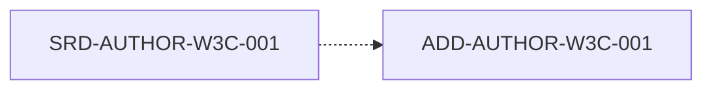

# Documento de Diseño Arquitectónico (ADD)

## HOJA DE CONTROL DOCUMENTAL
* **Proyecto:** MetsuOS Accessibility, Usability & Inclusion Standard
* **Código de Documento:** ADD-MetsuOS Accessibility, Usability & Inclusion Standard
* **Estado:** Consolidado

---

## 1. INTRODUCCIÓN Y ARQUITECTURA GENERAL
### 1.1 Propósito
Establecer el diseño conceptual, límites de componentes y la estructura de alto nivel del sistema **MetsuOS Accessibility, Usability & Inclusion Standard**.

### 1.2 Enfoque de Diseño
Estrategia de modularización, patrones de diseño y gestión de persistencia/red.

---

## 2. ESPECIFICACIONES ATÓMICAS DE ARQUITECTURA
## 📊 Grafo de Trazabilidad de la Fase

---

### ADD-AUTHOR-W3C-001: Criterio 1.1.1: Contenido no textual (Nivel A)
**Estado:** `DRAFT` | **Prioridad:** `HIGH` | **Verificación:** `TEST` | **Origen:** `AUTHOR-W3C`

#### Descripción
Todo el contenido no textual que se presenta al usuario tiene una alternativa de texto que sirve para el mismo propósito.

**Padres:** [[SRD-AUTHOR-W3C-001]]

---