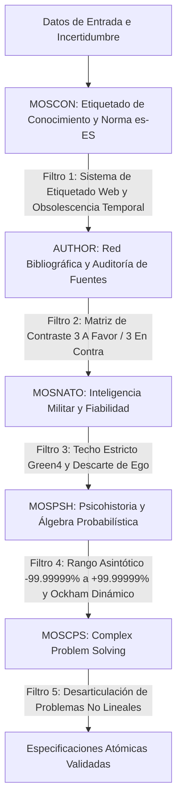
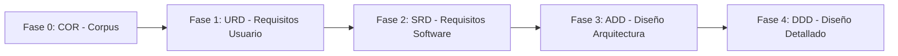

# MARCO CONCEPTUAL Y DOCUMENTO DE VISIÓN GENERAL (VISION) - MetsuOS Global Author & Bibliographic Corpus Standard

## HOJA DE CONTROL DOCUMENTAL

### INFORMACIÓN GENERAL DEL PROYECTO
* **Nombre del Proyecto:** MetsuOS Global Author & Bibliographic Corpus Standard
* **Código de Referencia:** MOSAUTHOR-COR-VISION
* **Estándar Metodológico Base:** ESA PSS-05 (Software Engineering Standards) / MOM Framework
* **Esquema MOM:** v0.5.2
* **Control de Revisiones:** Gestionado automáticamente vía Git Repository

---

### LISTA DE DISTRIBUCIÓN
* **Operadores del Sistema / Mantenedores Humanos**
* **Agentes de Inteligencia Artificial (AI Operators / Proposals Generators)**
* **Repositorio de Configuración Abierta de MetsuOS Global Author & Bibliographic Corpus Standard**

---

## 1. INTRODUCCIÓN Y PROPÓSITO

### 1.1 Objetivo del Documento
El presente documento establece la **introducción general, el marco conceptual, las decisiones de soberanía y los fundamentos doctrinales** del sistema **MetsuOS Global Author & Bibliographic Corpus Standard**.

Como proyecto integrado en la metodología **MOM**, este documento ofrece una **redacción narrativa continua**, estructurada bajo la rigurosidad formal del estándar **ESA PSS-05**, sirviendo como marco de alineación conceptual previo a la declaración de requisitos atómicos de usuario (`URD`), software (`SRD`) y diseño (`ADD`/`DDD`).

---

## 2. MARCO DOCTRINAL Y FILOSOFÍA DEL PROYECTO

# Visión y Doctrina: MOSAUTHOR (Global Author & Bibliographic Corpus Standard)

> **Proclamación Doctrinal:** MOSAUTHOR es el pilar raíz de la rama bibliográfica y epistemológica de MetsuOS. Define la arquitectura de almacenamiento, despiece atómico y evaluación de confiabilidad para todo el corpus de fuentes, autores y obras de referencia que sostienen o refutan la metodología y las especificaciones del sistema.

---

## 🏛️ Principios Doctrinales y Metodológicos

### 1. Herencia No Mandatoria y Enlace Implícito (Lazy Reference)
* **Inyección Transparente:** Todos los proyectos del ecosistema MetsuOS heredan de forma implícita y no mandatoria de `MOSAUTHOR` y sus derivados, sin necesidad de declarar formalmente la herencia en su `project.json`.
* **Resolución por Referencia Activa:** Un proyecto de desarrollo o especificación técnica solo extraerá e incluirá en su compilación los nodos bibliográficos que cite explícitamente (`parent_ids` / referencias de soporte), junto con su cadena ascendente estricta (Frase → Párrafo → Página → Capítulo → Obra → Autor). Los miles de nodos no citados del catálogo bibliográfico permanecen aislados para no contaminar la documentación del proyecto.

---

### 2. Mapeo Semántico de Fases ESA para Bibliografía
Para mantener la homogeneidad con el esquema de 5 fases ESA de MetsuOS sin alterar la estructura del compilador, se establece la siguiente equivalencia semántica de granularidad para la rama `AUTHOR-*`:

* **`COR` (Core / Visión):** Obra Completa, Corpus Global o Tesis Central (`AUTHOR-<Autor>-<Obra>`).
* **`URD` (User Requirements):** Capítulos, Partes o Secciones Principales de la obra.
* **`SRD` (System Requirements):** Páginas, Subsecciones o Pasajes concretos.
* **`ADD` (Architectural Design):** Párrafos o Argumentos Estructurados.
* **`DDD` (Detailed Design):** Frases Atómicas, Citas Textuales Directas o Proposiciones de Referencia.

---

### 3. Red de Evaluación Epistemológica Ponderada (`MOSCON` / `MOSNATO`)
* **Evaluación Local de Atómicos:** Cada nodo atómico (cita/frase) cuenta con su evaluación individual de confiabilidad de la fuente (A-F) y credibilidad de la información (1-6) según el estándar OTAN (`MOSNATO`) y el nivel de conocimiento (`MOSCON`).
* **Propagación Ascendente:** El valor de fiabilidad de una Obra (`COR`) o Autor (`AUTHOR-<Nombre>`) se computa mediante el agregado ponderado (media, mediana o límite de seguridad) de sus proposiciones atómicas.
* **Cálculo de Soporte y Contrapunto Cruzado:** Los requisitos de software o componentes de MetsuOS pueden vincularse con aristas de **soporte (+1)** o **refutación (-1)** desde múltiples frases en diversas obras. La fiabilidad neta del componente técnico se calcula automáticamente en función de la credibilidad de la evidencia bibliográfica a favor y en contra.

---

### 4. Estructura Topológica Invertida
La rama bibliográfica se organiza en vaults especializados con la siguiente jerarquía de proyectos:
1. `MOSAUTHOR` (Nodo Raíz Global)
2. `AUTHOR-<NombreAutor>` (Ejemplo: `AUTHOR-Platon`, `AUTHOR-W3C`)
3. `AUTHOR-<NombreAutor>-<Obra>` (Ejemplo: `AUTHOR-W3C-WCAG22`, `AUTHOR-Platon-LaRepublica`)

---

---

## 3. APLICACIÓN DE LOS CINCO PILARES EPISTEMOLÓGICOS Y SU TRAZABILIDAD CAUSAL

Para mitigar el ruido, la desinformación y los sesgos cognitivos propios de la ingesta de datos en el mundo real, la arquitectura del Corpus (Fase 0) articula cinco módulos especializados. Cada bloque cumple una función específica dentro de la cadena de procesamiento del conocimiento:

---

## 4. ESTRUCTURA Y CICLO DE VIDA EN ESA PSS-05 / MOM

El ciclo de vida en MetsuOS Global Author & Bibliographic Corpus Standard sigue una progresión formal de 5 fases interconectadas:

### 4.1 Descripción Narrativa de las Fases

#### Fase 0: COR (Corpus de Filosofía, Axiomas, Epistemología y Estándares)
* **Propósito:** Definir los marcos éticos, tecnológicos, epistemológicos (`MOSCON`, `AUTHOR`, `MOSNATO`, `MOSPSH`, `MOSCPS`) y de soberanía del proyecto.
* **Carácter:** Raíz inmutable del grafo de herencia.

#### Fase 1: URD (User Requirements Document)
* **Propósito:** Especificar las necesidades operativas del usuario final o del cliente.
* **Carácter:** Define qué debe hacer el sistema desde una perspectiva funcional, vinculándose formalmente a los axiomas y límites del `COR`.

#### Fase 2: SRD (Software Requirements Document)
* **Propósito:** Traducir los `URD` a requisitos técnicos verificables de software.
* **Carácter:** Define las interfaces, formatos de datos, límites de memoria y métodos de verificación (`TEST`, `INSPECTION`, `ANALYSIS`, `DEMONSTRATION`).

#### Fase 3: ADD (Architectural Design Document)
* **Propósito:** Definir la estructura modular de alto nivel, la descomposición en subsistemas y la estrategia de persistencia/red.
* **Carácter:** Mapea la transformación de `SRD` a módulos arquitectónicos concretos.

#### Fase 4: DDD (Detailed Design Document)
* **Propósito:** Especificar las estructuras de datos exactas, algoritmos, firmas de funciones y modelos de clases/ficheros.
* **Carácter:** Base directa para la codificación y compilación.

---

## 5. GOBERNANZA Y MODO DE TRABAJO CON INTELIGENCIA ARTIFICIAL

MetsuOS Global Author & Bibliographic Corpus Standard establece una separación clara de roles para prevenir el descontrol de código o especificaciones generadas automáticamente:

1. **Agentes de IA (Proposers):** Leen el contexto del proyecto (`AGENTS.md`, notas del `vault/` de Obsidian y especificaciones consolidadas) y generan propuestas atómicas estructuradas en `data/ai-proposals/`.
2. **Operador Humano (Approver):** Ejecuta la herramienta de gestión CLI (`cli.py`), revisa las propuestas en orden estricto de llegada (FIFO), evalúa los *AI Guardrails* e integra o descarta los elementos.

---

## 6. CONCLUSIÓN Y CONTINUIDAD OPERATIVA

Este documento constituye la piedra angular narrativa del proyecto **MetsuOS Global Author & Bibliographic Corpus Standard**. Toda iteración sobre el código o sobre los proyectos creados dentro de la estructura `data/projects/` toma esta visión como el marco doctrinal predeterminado.