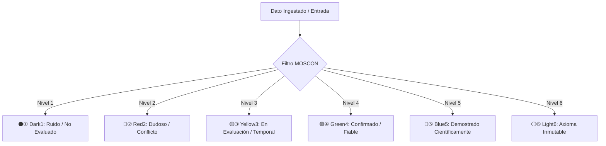
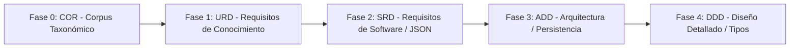

# MARCO CONCEPTUAL Y DOCUMENTO DE VISIÓN GENERAL (VISION) - MOSCON

## HOJA DE CONTROL DOCUMENTAL

### INFORMACIÓN GENERAL DEL PROYECTO
* **Nombre del Proyecto:** MOSCON (MetsuOS Conocimiento y Etiquetado)
* **Código de Referencia:** MOSCON-COR-VISION-1.0
* **Entidad / Dominio:** MetsuOS Ecosystem / Knowledge Management
* **Estándar Metodológico Base:** ESA PSS-05 (Software Engineering Standards) / MOM Framework
* **Versión Actual:** 1.0.0
* **Fecha de Emisión:** 17 de Octubre de 2026

---

### REGISTRO DE CAMBIOS Y HISTORIAL DE VERSIONES
| Versión | Descripción del Cambio | Autor / Rol | Fecha |
| :---: | :--- | :---: | :---: |
| **1.0.0** | Elaboración inicial del Documento de Visión Narrativa para MOSCON, formalización de la escala cromática de 6 niveles y norma de dominio es-ES. | Metsuke (Arquitecto Principal) | 17/10/2026 |

---

### LISTA DE DISTRIBUCIÓN
* **Operadores del Sistema / Mantenedores Humanos**
* **Agentes de Inteligencia Artificial (AI Operators / Proposals Generators)**
* **Repositorio de Configuración Abierta de MOSCON**

---

## 1. INTRODUCCIÓN Y PROPÓSITO

### 1.1 Objetivo del Documento
El presente documento establece la **introducción general, el marco conceptual, las decisiones de soberanía y las reglas de taxonomía** del sistema **MOSCON (MetsuOS Conocimiento y Etiquetado)**.

Como proyecto derivado de la metodología **MOM**, este documento ofrece una **redacción narrativa continua**, estructurada bajo la rigurosidad formal del estándar **ESA PSS-05**, sirviendo como marco de alineación conceptual previo a la declaración de requisitos atómicos de usuario (`URD`), software (`SRD`) y diseño (`ADD`/`DDD`).

### 1.2 Alcance del Sistema MOSCON
MOSCON es el módulo central encargado del etiquetado cromático y la clasificación del conocimiento en MetsuOS mediante:
1. **Escala Cromática de 6 Niveles ("Bolitas de Colores"):** Clasificación del dato desde el ruido/incertidumbre (`⚫① Dark1`) hasta la verdad axiomática/inmutable (`⚪⑥ Light6`).
2. **Norma Geopolítica `es-ES`:** Establecimiento del español de España como lenguaje operativo y de contexto primario.
3. **Control de Obsolescencia Temporal ($\lambda$):** Degradación automática de la certidumbre basada en el tiempo y el ratio de caducidad.

---

## 2. MARCO DOCTRINAL Y FILOSOFÍA DE SOBERANÍA (CORPUS - FASE 0)

### 2.1 Naturaleza del Documento COR y Pre-URD en MOSCON
En MetsuOS, la validez del dato, el nivel de certeza y el idioma operativo actúan como restricciones inmutables de **Nivel 0 (COR / Corpus)**.

El **Corpus de Filosofía y Estándares (COR)** de MOSCON determina:
* **El Requisito de Usuario (URD):** Ningún elemento de información puede integrarse sin una etiqueta de certidumbre válida.
* **El Requisito de Software (SRD):** Las estructuras de datos deben incluir obligatoriamente los campos de nivel cromático, idioma y tasa de obsolescencia.
* **El Diseño de Arquitectura (ADD) y Detallado (DDD):** Los esquemas de persistencia y serialización JSON deben soportar los tipos de estado definidos por MOSCON.

---

## 3. ESCALA CROMÁTICA Y REGLAS DE ETIQUETADO EN MOSCON

MOSCON implementa formalmente la escala de 6 niveles definida en el sistema oficial:

---

## 4. ESTRUCTURA Y CICLO DE VIDA EN ESA PSS-05 / MOSCON

El desarrollo y despliegue del sistema sigue las 5 fases estandarizadas de MOM:

---

## 5. CONCLUSIÓN Y CONTINUIDAD OPERATIVA

Este documento constituye la piedra angular conceptual del proyecto **MOSCON**. Toda especificación atómica creada en `data/projects/MOSCON/specs/` y toda compilación documental hacia `doc/` y `vault/` se fundamentan en los principios narrativos de etiquetado y certeza establecidos en esta Visión.