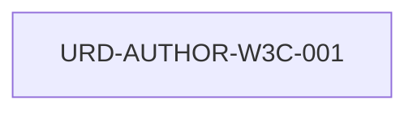

# Documento de Requisitos de Usuario (URD)

## HOJA DE CONTROL DOCUMENTAL
* **Proyecto:** MetsuOS Consolidated Core Architecture
* **Código de Documento:** URD-MetsuOS Consolidated Core Architecture
* **Estado:** Consolidado

---

## 1. INTRODUCCIÓN
### 1.1 Propósito
El propósito de este documento es definir formalmente las necesidades y requisitos de los usuarios del sistema **MetsuOS Consolidated Core Architecture**.

### 1.2 Alcance
Este documento constituye la base para la fase de definición de requisitos de software y servirá como criterio final de aceptación por parte del cliente/usuario.

### 1.3 Destinatarios
Equipo directivo, analistas de negocio, arquitectos de software y agentes de automatización/IA.

### 1.4 Referencias y Estándares
* Estándar ESA PSS-05 (Software Engineering Standards).

---

## 2. DESCRIPCIÓN GENERAL
### 2.1 Visión General del Sistema
Breve contextualización de las capacidades solicitadas para el proyecto **MetsuOS Consolidated Core Architecture**.

### 2.2 Características de los Usuarios
Definición de perfiles, roles y permisos esperados.

### 2.3 Restricciones Generales
Condicionantes de entorno, normativas legales, interoperabilidad o presupuestarias.

---

## 3. ESPECIFICACIONES ATÓMICAS DE REQUISITOS DE USUARIO
## 📊 Grafo de Trazabilidad de la Fase

---

### URD-AUTHOR-W3C-001: Principio 1: Perceptible
**Estado:** `DRAFT` | **Prioridad:** `HIGH` | **Verificación:** `TEST` | **Origen:** `AUTHOR-W3C`

#### Descripción
La información y los componentes de la interfaz de usuario deben ser presentables a los usuarios en formas que puedan percibir.

**Hijos:** [[SRD-AUTHOR-W3C-001]]
**Refuta a:** [[S]]

---