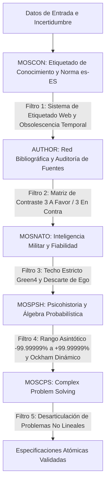
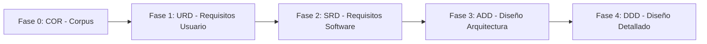

# MARCO CONCEPTUAL Y DOCUMENTO DE VISIÓN GENERAL (VISION) - MetsuOS Consolidated Core Architecture

## HOJA DE CONTROL DOCUMENTAL

### INFORMACIÓN GENERAL DEL PROYECTO
* **Nombre del Proyecto:** MetsuOS Consolidated Core Architecture
* **Código de Referencia:** MOSCOR-COR-VISION
* **Estándar Metodológico Base:** ESA PSS-05 (Software Engineering Standards) / MOM Framework
* **Esquema MOM:** v0.5.2
* **Control de Revisiones:** Gestionado automáticamente vía Git Repository

---

### LISTA DE DISTRIBUCIÓN
* **Operadores del Sistema / Mantenedores Humanos**
* **Agentes de Inteligencia Artificial (AI Operators / Proposals Generators)**
* **Repositorio de Configuración Abierta de MetsuOS Consolidated Core Architecture**

---

## 1. INTRODUCCIÓN Y PROPÓSITO

### 1.1 Objetivo del Documento
El presente documento establece la **introducción general, el marco conceptual, las decisiones de soberanía y los fundamentos doctrinales** del sistema **MetsuOS Consolidated Core Architecture**.

Como proyecto integrado en la metodología **MOM**, este documento ofrece una **redacción narrativa continua**, estructurada bajo la rigurosidad formal del estándar **ESA PSS-05**, sirviendo como marco de alineación conceptual previo a la declaración de requisitos atómicos de usuario (`URD`), software (`SRD`) y diseño (`ADD`/`DDD`).

---

## 2. MARCO DOCTRINAL Y FILOSOFÍA DEL PROYECTO

> ⚠️ **[PENDIENTE DE DEFINICIÓN]**

*(El archivo VISION_PHILOSOPHY.md existe pero está vacío. Edita este archivo en el directorio del proyecto para incluir el marco doctrinal de este dominio)*

---

## 3. APLICACIÓN DE LOS CINCO PILARES EPISTEMOLÓGICOS Y SU TRAZABILIDAD CAUSAL

Para mitigar el ruido, la desinformación y los sesgos cognitivos propios de la ingesta de datos en el mundo real, la arquitectura del Corpus (Fase 0) articula cinco módulos especializados. Cada bloque cumple una función específica dentro de la cadena de procesamiento del conocimiento:

---

## 4. ESTRUCTURA Y CICLO DE VIDA EN ESA PSS-05 / MOM

El ciclo de vida en MetsuOS Consolidated Core Architecture sigue una progresión formal de 5 fases interconectadas:

### 4.1 Descripción Narrativa de las Fases

#### Fase 0: COR (Corpus de Filosofía, Axiomas, Epistemología y Estándares)
* **Propósito:** Definir los marcos éticos, tecnológicos, epistemológicos (`MOSCON`, `AUTHOR`, `MOSNATO`, `MOSPSH`, `MOSCPS`) y de soberanía del proyecto.
* **Carácter:** Raíz inmutable del grafo de herencia.

#### Fase 1: URD (User Requirements Document)
* **Propósito:** Especificar las necesidades operativas del usuario final o del cliente.
* **Carácter:** Define qué debe hacer el sistema desde una perspectiva funcional, vinculándose formalmente a los axiomas y límites del `COR`.

#### Fase 2: SRD (Software Requirements Document)
* **Propósito:** Traducir los `URD` a requisitos técnicos verificables de software.
* **Carácter:** Define las interfaces, formatos de datos, límites de memoria y métodos de verificación (`TEST`, `INSPECTION`, `ANALYSIS`, `DEMONSTRATION`).

#### Fase 3: ADD (Architectural Design Document)
* **Propósito:** Definir la estructura modular de alto nivel, la descomposición en subsistemas y la estrategia de persistencia/red.
* **Carácter:** Mapea la transformación de `SRD` a módulos arquitectónicos concretos.

#### Fase 4: DDD (Detailed Design Document)
* **Propósito:** Especificar las estructuras de datos exactas, algoritmos, firmas de funciones y modelos de clases/ficheros.
* **Carácter:** Base directa para la codificación y compilación.

---

## 5. GOBERNANZA Y MODO DE TRABAJO CON INTELIGENCIA ARTIFICIAL

MetsuOS Consolidated Core Architecture establece una separación clara de roles para prevenir el descontrol de código o especificaciones generadas automáticamente:

1. **Agentes de IA (Proposers):** Leen el contexto del proyecto (`AGENTS.md`, notas del `vault/` de Obsidian y especificaciones consolidadas) y generan propuestas atómicas estructuradas en `data/ai-proposals/`.
2. **Operador Humano (Approver):** Ejecuta la herramienta de gestión CLI (`cli.py`), revisa las propuestas en orden estricto de llegada (FIFO), evalúa los *AI Guardrails* e integra o descarta los elementos.

---

## 6. CONCLUSIÓN Y CONTINUIDAD OPERATIVA

Este documento constituye la piedra angular narrativa del proyecto **MetsuOS Consolidated Core Architecture**. Toda iteración sobre el código o sobre los proyectos creados dentro de la estructura `data/projects/` toma esta visión como el marco doctrinal predeterminado.