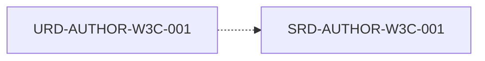

# Documento de Requisitos de Software (SRD)

## HOJA DE CONTROL DOCUMENTAL
* **Proyecto:** World Wide Web Consortium
* **Código de Documento:** SRD-World Wide Web Consortium
* **Estado:** Consolidado

---

## 1. INTRODUCCIÓN
### 1.1 Propósito
Especificar técnicamente las capacidades funcionales, no funcionales y de rendimiento del software para **World Wide Web Consortium**.

### 1.2 Alcance
Traducción técnica formal de las necesidades expresadas en el Documento de Requisitos de Usuario (URD).

### 1.3 Trazabilidad
Todos los requisitos definidos en este documento heredan estrictamente de uno o más componentes definidos en el URD.

---

## 2. ENTORNO Y RESTRICCIONES TÉCNICAS
### 2.1 Modelo Operativo
Plataformas de ejecución, entornos de soporte y dependencias de infraestructura.

---

## 3. ESPECIFICACIONES ATÓMICAS DE REQUISITOS SOFTWARE
## 📊 Grafo de Trazabilidad de la Fase

---

### SRD-AUTHOR-W3C-001: Pauta 1.1: Alternativas de texto
**Estado:** `DRAFT` | **Prioridad:** `HIGH` | **Verificación:** `TEST` | **Origen:** `AUTHOR-W3C`

#### Descripción
Proporcionar alternativas de texto para cualquier contenido no textual.

**Padres:** [[URD-AUTHOR-W3C-001]]
**Hijos:** [[ADD-AUTHOR-W3C-001]]
**Apoya a:** [[S]]
**Refuta a:** [[S]]

---