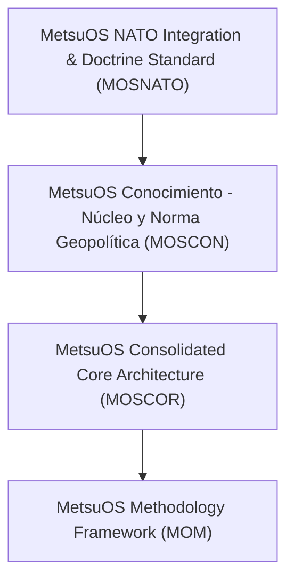

# 🌐 METSUOS METHODOLOGY (MOM) - VAULT GLOBAL DE CONOCIMIENTO

> **Visión Holística del Sistema:** Este Vault consolida todos los proyectos públicos de MetsuOS y resuelve el grafo DAG de herencia de conocimiento y especificaciones atómicas.

---

## 🌳 Grafo de Jerarquía de Proyectos

---

## 📋 Leyenda y Accesos Directos a Proyectos

1. **[[MOM/INDEX|MOM]]**: MetsuOS Methodology Framework (`Fase COR`) - Metodología atómica y framework de trazabilidad para el desarrollo soberano de software, especificaciones ESA PSS-05 e integración de agentes de IA.
1. **[[MOSCON/INDEX|MOSCON]]**: MetsuOS Conocimiento - Núcleo y Norma Geopolítica (`Fase COR`) - Proyecto raíz del Corpus de MOM. Define la física interna del dato, la norma geopolítica de lenguaje operativo es-ES y las reglas de degradación temporal por obsolescencia.
1. **[[MOSCOR/INDEX|MOSCOR]]**: MetsuOS Consolidated Core Architecture (`Fase COR`) - Sin descripción
1. **[[MOSNATO/INDEX|MOSNATO]]**: MetsuOS NATO Integration & Doctrine Standard (`Fase COR`) - Sin descripción

---
*Última compilación global realizada por el proyecto: `MOM`*
