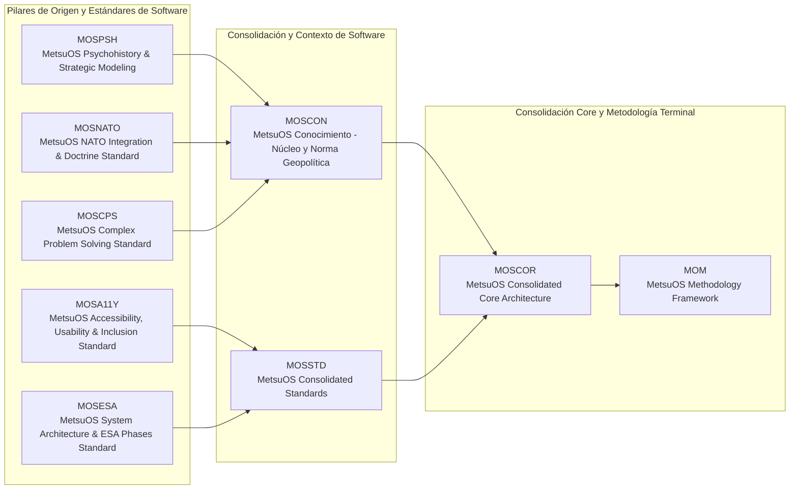
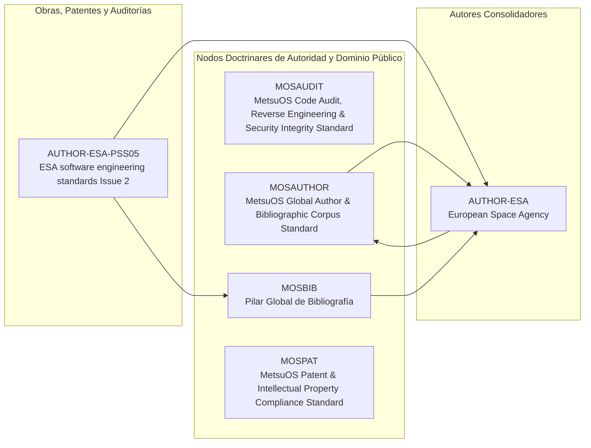

# METSUOS METHODOLOGY (MOM) - VAULT GLOBAL DE CONOCIMIENTO ⚫①

> **Visión Holística del Sistema:** Este Vault consolida todos los proyectos públicos de MetsuOS y resuelve el grafo DAG de herencia de conocimiento y especificaciones atómicas dividiendo la arquitectura de software del corpus bibliográfico.

---

## 🏛️ 1. Arquitectura de Proyectos de Software y Core MOM

### 📋 Leyenda y Enlaces de Proyectos Core
1. **[[MOM/INDEX|MOM]]**: MetsuOS Methodology Framework (`Fase COR`) - Sin descripción
1. **[[MOSA11Y/INDEX|MOSA11Y]]**: MetsuOS Accessibility, Usability & Inclusion Standard (`Fase COR`) - Sin descripción
1. **[[MOSCON/INDEX|MOSCON]]**: MetsuOS Conocimiento - Núcleo y Norma Geopolítica (`Fase COR`) - Sin descripción
1. **[[MOSCOR/INDEX|MOSCOR]]**: MetsuOS Consolidated Core Architecture (`Fase COR`) - Sin descripción
1. **[[MOSCPS/INDEX|MOSCPS]]**: MetsuOS Complex Problem Solving Standard (`Fase COR`) - Sin descripción
1. **[[MOSESA/INDEX|MOSESA]]**: MetsuOS System Architecture & ESA Phases Standard (`Fase COR`) - Sin descripción
1. **[[MOSNATO/INDEX|MOSNATO]]**: MetsuOS NATO Integration & Doctrine Standard (`Fase COR`) - Sin descripción
1. **[[MOSPSH/INDEX|MOSPSH]]**: MetsuOS Psychohistory & Strategic Modeling (`Fase COR`) - Sin descripción
1. **[[MOSSTD/INDEX|MOSSTD]]**: MetsuOS Consolidated Standards (`Fase COR`) - Sin descripción

---

## 📚 2. Corpus Bibliográfico, Autores, Patentes y Dominio Público

### 📋 Leyenda y Enlaces de Fuentes Bibliográficas
1. **[[AUTHOR-ESA/INDEX|AUTHOR-ESA]]**: European Space Agency
1. **[[AUTHOR-ESA-PSS05/INDEX|AUTHOR-ESA-PSS05]]**: ESA software engineering standards Issue 2 - Despiece atómico de ESA software engineering standards Issue 2
1. **[[MOSAUDIT/INDEX|MOSAUDIT]]**: MetsuOS Code Audit, Reverse Engineering & Security Integrity Standard - Sin descripción
1. **[[MOSAUTHOR/INDEX|MOSAUTHOR]]**: MetsuOS Global Author & Bibliographic Corpus Standard - Sin descripción
1. **[[MOSBIB/INDEX|MOSBIB]]**: Pilar Global de Bibliografía - Pilar herencial de obras y fuentes bibliográficas
1. **[[MOSPAT/INDEX|MOSPAT]]**: MetsuOS Patent & Intellectual Property Compliance Standard - Sin descripción

---
*Última compilación global realizada por el proyecto: `MOM`*
